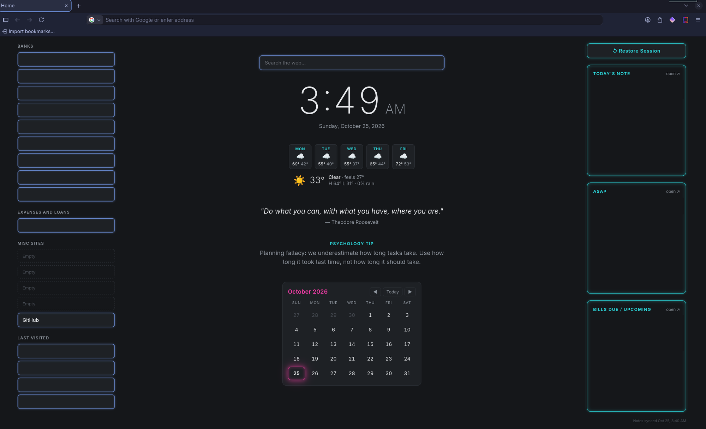

# Homepage

Offline Firefox start page. Single file (`index.html`), no internet needed to load.

| Status | Last updated | Type |
|---|---|---|
| Working (Firefox start page + new tab on this computer) | 2026-10-30 | Static HTML page + Python note sync |

## Open it
- **On this computer:** open Firefox (it's the start page and every new tab), or open `index.html` directly.
- **Anywhere else:** download this folder and double-click `index.html`. Opening it inside Google Drive only shows the code.

## Files
| File | What it is |
|---|---|
| `index.html` | The page: HTML, CSS and JavaScript in one file |
| `sync_notes.py` | Copies today's note, ASAP, Bills and the current Omarchy theme colors into `notes.js` |
| `README.md` | This file |
| `CHANGELOG.md` | Every change, newest at the bottom |
| `fonts/` | Ubuntu and Pirata One fonts (offline) with their licences |
| `firefox/`, `systemd/`, `widgets/`, `omarchy/` | Install files for the new-tab page, auto-sync, Start Desktop Widgets and the theme hook |



## Layout
- **Left pane:** link buttons by group (Banks, Expenses and Loans). Edit the `LINKS` list at the top of the script in `index.html`.
- **Center:** large 12-hour digital clock and date, then an **Ask Claude** box (opens claude.ai in a new tab with your question filled in), the 5-day forecast and today's weather, the daily quote and tip, and a month calendar (today glows; ◀ ▶ and Today buttons).
- **Right pane:** Restore Session (needs `firefox/mozilla.cfg` installed), Start Desktop Widgets, View Progress Log and the **Theme** menu, then Today's Note, ASAP and Bills Due / Upcoming from the ScrapYard vault.

## Notes from Obsidian
Run `./sync_notes.py` to copy today's daily note, `ASAP.md` and `Bills Due This Month.md` into `notes.js` (not committed). Only open tasks show for ASAP and Bills.

Automatic: systemd user units in `~/.config/systemd/user/` re-run the sync when the vault root or `01 - Home/Daily Notes/` changes (`homepage-notes.path`), after midnight and at login (`homepage-notes.timer`). The open page re-reads `notes.js` every minute. Turn off with `systemctl --user disable --now homepage-notes.path homepage-notes.timer`. Give a bill a due date with `📅 2026-11-03` or `due 15` (every month) to get a dot on the calendar.

## Themes
Pick one from the **Theme** menu under View Progress Log. The choice is saved in this browser.

| Theme | Look |
|---|---|
| Match Desktop | Uses the current Omarchy theme colors (read by `sync_notes.py`) |
| Neon (default) | Dark, blue outlines, cyan headings, pink highlights |
| Tokyo Night, Catppuccin, Dracula, Atom One Dark, Nord, Gruvbox | The well-known editor color schemes |
| Purple, Synthwave | Dark purple variations |
| Light | Light grey and white |
| Old Notebook | A light, slightly worn journal page (no lines), ink colors, Pirata One "pirate" lettering |

Each theme is a block of colors at the top of the `<style>` section (`[data-theme="…"]`); the menu list is `THEMES` at the bottom of the script.

**Match Desktop updates** whenever the notes sync runs (note changes, midnight, login). To make it follow a theme change right away, install the Omarchy hook (no sudo):
```bash
install -Dm755 omarchy/theme-set-homepage ~/.config/omarchy/hooks/theme-set.d/homepage
```

## Firefox
Opens at startup and on the Home button via two lines in `~/.config/mozilla/firefox/e1fxaqv2.default-release/user.js`. Delete them to undo.

New tabs: `sudo firefox/install-newtab.sh` copies `autoconfig.js` and `mozilla.cfg` into `/usr/lib/firefox` (Firefox autoconfig sets the new-tab URL). Undo with `sudo firefox/install-newtab.sh --remove`. Re-run if a Firefox update ever removes it.

## License

[MIT](LICENSE) © 2026 Matthew Birtwistle. The bundled fonts keep their own licences: Ubuntu (`fonts/LICENSE.txt`) and Pirata One, SIL Open Font License (`fonts/PIRATA-OFL.txt`).
